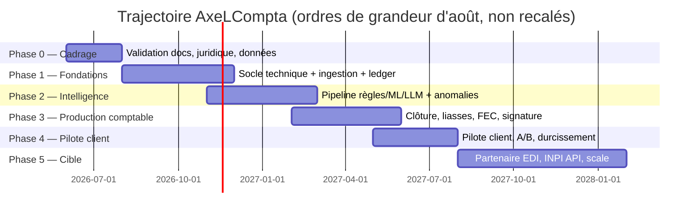

# 12 — Roadmap et TODO maître

> Statut : brouillon à valider. Dernière mise à jour : 2026-11-10.
> **Seule source de l'état du projet dans le repo** (fait, en cours, prévu).
> Le suivi au jour le jour est dans Linear, projet
> [Axel Compta — V1 prod](https://linear.app/axel-project/project/axel-compta-v1-prod-api-ingestion-fiabilite-899778ce7b41)
> (P-AXE-28) ; ce doc en donne la photo et les décisions. Les docs 17 et 18
> n'en tiennent pas de copie.
>
> Capacité : Louis sur le produit, Arthur en renfort depuis fin octobre
> (revues UX AXE-563/564, performance AXE-565 à 567). Une partie du code
> d'octobre et de novembre est écrite par des agents (Cursor) et relue par
> Louis.
>
> Le recalage de septembre (jalons J1 à J6, travail du 21/09 au 27/09, PR
> #3 à #39) est archivé tel quel dans
> [archive/12-recalage-2026-09.md](archive/12-recalage-2026-09.md).

## État au 2026-11-10 (à lire avant tout le reste)

**En une phrase :** la plateforme est en mode réel depuis le 05/11, et la
semaine du 05 au 10/11 a fermé presque tous les trous de fiabilité de
l'analyse critique (invariants I3, I4, I7, contre-passations des décisions,
MFA, mode expert avec responsabilité de l'expert-comptable, TVA en cours
d'année, rappels par e-mail et SMS). Ce qui manque pour la V1 : **un mois
réel exporté** (AXE-733), le cœur comptable VTC (versements de plateformes,
véhicule, bilan d'ouverture), puis la mise en production.

**Où on en est par rapport au plan.** Le projet Linear « Moteur & exports
(démo) » est clos depuis le 17/10. Le projet « V1 prod » (cible
**31/12/2026**, initiative « Prod-ready trio → Market janv. 2027 ») a avancé
sur son chemin critique : comptes bancaires retenus (AXE-729), contre-
passations des décisions humaines (AXE-420) et de la quarantaine (AXE-424),
configuration confirmée par le chauffeur (AXE-730). **Pas encore fait** : la
première synchro des chauffeurs réels (AXE-728) et le mois exporté
(AXE-733). Aucun dossier `DIGI_` n'a encore été tranché ni clôturé de bout
en bout (ancien J3).

**Attention : code mergé ≠ production à jour.** Les reprises de données et
la mise en route des tickets mergés (Sirene, tags, comptes bancaires,
décisions, crontab, jeton `/metrics`) restent à appliquer sur la base
réelle (AXE-842). Des écritures sont restées au 471 après la synchro sans
modèle du 05/11 (AXE-850).

Client de référence V1 : Serenity Gestion, installé étape par étape avant
toute autre vente.

### Fait du 2026-11-05 au 2026-11-10 (PR #87 à #123)

**Grand livre et invariants du doc 06**
- I4 (AXE-806, #91) : aucune écriture datée dans un exercice clos, refusée
  en base par trigger. Une correction d'exercice clos est datée du premier
  jour de l'exercice ouvert du dossier (AXE-838, #103). Une opération
  bancaire tardive dans un exercice clos part en quarantaine.
- I3 et I7 (AXE-807, #92) : numérotation continue par dossier et par
  exercice, posée par trigger dans la transaction ; contrôle quotidien de la
  balance (3 h), alerte Sentry et métrique `balance_desequilibree_total`,
  sans correction automatique.
- Décisions humaines au grand livre (AXE-420, #93) : chaque décision écrit
  une OD de reclassement `{S}:decision-{k}` du compte en vigueur vers le
  nouveau ; annulation = retour en 471. Décision et OD dans la même
  transaction (AXE-852, #114). Reprise des décisions d'avant :
  `scripts/materialiser_decisions.py`.
- Quarantaine d'ingestion résolue par le gestionnaire (AXE-424, #97) :
  accepter un montant modifié (contre-passation puis nouveau montant),
  ignorer ; écran « Opérations bancaires à revoir » dans Anomalies.
- Un sous-compte 512 par compte bancaire (5121, 5122…) et solde comptable
  face au solde de la banque (AXE-832, #87).
- Libellés d'écritures sans la catégorie entre parenthèses (AXE-848, #118).

**TVA (AXE-805, #121)**
- CA3 de chaque période (mensuelle ou trimestrielle), échéance, écriture de
  liquidation vers 44551 ou 44567, déclaration avec preuve. La CA3 annuelle
  de la liasse reprend la somme des périodes. Rappels J-7 et J-2. Écran
  « Ma TVA » côté chauffeur.

**Mode expert et responsabilité juridique (AXE-800, #120)**
- Rôle `expert_comptable` habilité par un admin (cabinet, Ordre, lettre de
  mission, dossiers couverts) ; engagement de responsabilité versionné ;
  motif obligatoire sur chaque imputation, annulation et qualification. Le
  mode expert, les anomalies, les opérations classées et la quarantaine lui
  sont réservés. Le chauffeur voit « Reclassée par [nom], expert-comptable ».
- Opérations déjà classées : filtres, verdicts « juste » / « faux »
  (AXE-823, #99) ; moyen de paiement affiché (AXE-855, #117).
- Performance (AXE-824, #100) : index et cache de la file expert ; à 200
  dossiers × 300 écritures, file expert 11,5 s → 0,14 s.

**Catégorisation et anomalies**
- Ordre du pipeline : virements internes, règles du pack, modèle, puis
  catégorie de la banque (Bridge) en simple proposition ; 7 règles VTC
  ajoutées (AXE-826, #88). Sans modèle ML, MK DRIVING passe de 18 % à 56 %
  d'opérations classées seules, B'CARS de 6 % à 44 %.
- Sans modèle de catégorisation, la synchro s'arrête et le dit (AXE-825,
  #111) ; repli sur les règles seules avec `AXELCOMPTA_SANS_MODELE=1`.
- Plancher réglable par règle : sous 5 €, la règle carburant propose sans
  imputer (AXE-837, #106).
- Retraits d'espèces : une question dédiée au chauffeur (AXE-844, #108).
- Qualifications d'anomalies en base, avec historique (AXE-814, #98) ;
  détecteurs carburant affinés et moyen de paiement sous chaque alerte
  (AXE-836, #107).

**Dossiers et onboarding**
- Création des dossiers en masse depuis un CSV, avec rapport ligne par
  ligne avant création (AXE-809, #95).
- L'import pose l'exercice, la forme et l'activité depuis Sirene (AXE-834,
  #89) ; le chauffeur confirme sa configuration, et clôture et liasse
  l'attendent (AXE-730, #109).
- Comptes bancaires retenus, écartés ou à décider (AXE-729, #110) ; le
  gestionnaire voit ceux qui attendent un choix (AXE-851, #113).
- Nouveaux chauffeurs Digifactory proposés dans Entreprises, bouton
  « Synchroniser » exécuté par le worker (AXE-845, #105).
- Tags d'entreprises et exclusion des traitements (AXE-829, #90).
- Rappels envoyés par le SMTP ou le fournisseur SMS du gestionnaire,
  paramètres chiffrés, lien de désinscription (AXE-808, #122).

**Sécurité, production et qualité**
- MFA native de Supabase demandée à l'admin et à l'expert-comptable
  (jeton `aal2`), journal des connexions et des exports, « Accès à votre
  dossier » pour le dirigeant (AXE-812, #101). `tenants/mfa.py` retiré.
- Production isolée (AXE-810, #94) : `/metrics` fermé sans
  `METRICS_TOKEN`, verrous du rôle web testés.
- Compte de test en lecture seule qui ouvre l'espace chauffeur de tout
  dossier du portefeuille, avec date de fin et trace d'audit (AXE-822,
  #119, #123).
- Erreurs métier en 4xx avec leur phrase, jamais 500 (AXE-839, #104 ;
  AXE-853, #116). Une seule tête Alembic en CI, l'API refuse une base en
  retard (AXE-841, #102, #112) ; le test des migrations compare tout le
  schéma au modèle ORM (AXE-854, #115).

### Fait du 2026-09-27 au 2026-11-05 (PR #41 à #86)

**Liasse et exports (AXE-438, AXE-422, AXE-557, AXE-558 ; 14-15/10 et 24-25/10)**
- La liasse est contrôlée avant d'être livrée : équilibre, résultat,
  totaux, contrôles inter-cases (`test_controles_tdfc`).
- CA3 calculée en centimes et rangée dans la liasse pivot.
- Réel normal (`regime_liasse = "2050"`) : bilan 2050/2051, compte de
  résultat 2052/2053, totaux 2054, 2055, 2056, 2058-A et 2058-B, repris des
  mêmes chiffres que la 2033. Pas de PDF CERFA 2050, pas de lignes de
  détail. La 2033 reste la liasse par défaut.
- CCA et FNP : le chauffeur saisit le montant, le compte et le libellé ;
  l'estimation entre dans la liasse, le FEC et l'aperçu de clôture
  (`provisions_cloture`). Le moteur ne décide jamais seul d'une provision.
- FEC : validateur A.47 A-1 (colonnes, dates, équilibre). Il reste un
  fichier texte, affiché « FEC » à l'écran. Toujours pas passé dans Test
  Compta Demat (outil Windows de la DGFiP).
- Une case à zéro reste vide sur les formulaires et les exports ; le FEC
  garde `0,00`.
- Bilan simplifié équilibré avec le capital (101x) et les immobilisations
  (2x) (AXE-421).
- Amendes : le calcul était déjà juste (CGI art. 39-2), verrouillé par un
  test (AXE-559).
- Reste sur AXE-484 (priorité basse) : lignes de détail du 2054, 2057,
  2058-C, 2059, Test Compta Demat.

**Modules V1 posés (23-25/10)**
- `anomaly/` (AXE-437) : profil par dossier et détecteurs V1 (personnel,
  enseigne ambiguë, écart 3σ, doublon de pièce, double plein). Le
  gestionnaire qualifie une alerte sur `/anomalies/{dossier}`.
  Les qualifications, d'abord en mémoire de process, sont en base depuis
  le 06/11 (AXE-814).
- `documents/` (AXE-425) : les photos de justificatifs sont en base
  (`justificatifs`), par tenant et dossier, avec empreinte, 8 Mo max, RLS.
  La photo n'est toujours pas lue (pas d'OCR).
- `pseudonymize/` (AXE-436) : seule porte vers un LLM. Un prompt qui
  contient encore un IBAN, un e-mail, un téléphone, une carte, une plaque,
  un NIR ou un nom connu du dossier est refusé. `LLMProvider` n'accepte que
  ce type. **Aucun fournisseur LLM n'est branché.**
- `jobs/` et `tenants/mfa.py` (AXE-442) : file de jobs Postgres
  (`FOR UPDATE SKIP LOCKED`, ADR-002), TOTP RFC 6238, rôles lecture,
  membre, admin. La file de jobs sert depuis le 09/11 au worker (import des
  dossiers, « Synchroniser », rappels). Le TOTP maison a été remplacé par
  la MFA native de Supabase le 09/11 (AXE-812).
- Observabilité (AXE-426) : `GET /metrics` (Prometheus), journal JSON,
  Sentry s'il y a un DSN (vide en local).
- `api.app` est le point d'entrée (`uvicorn axelcompta.api.app:app`, AXE-428)
  avec `GET /sante`. Les routes vivent encore dans `demo_api.py` : la
  migration route par route vers les façades reste à faire.

**Gestionnaire**
- Mode expert (AXE-560, puis AXE-694/695) : file de tout ce qui est à
  traiter, tous dossiers confondus, 50 par page, filtres. « Imputer »
  annonce qu'il écrit en comptabilité, contre-passe l'écriture d'origine,
  et s'annule.
- Entreprises (AXE-561, AXE-696/697) : filtres par étape restante, état
  dans l'URL, tri, pagination à 25, fiche qui reste à l'écran, dossiers
  retirés qui se restaurent.
- Rôles appliqués dans l'interface (AXE-701) : le rôle Lecture ne voit pas
  les actions d'écriture ; retirer un membre pose le rôle `retire`.
- Invitations (AXE-702) : en masse, renvoi, annulation.
- Rappels (AXE-698/699) : plus de doublons de règles préfaites, règles
  suspendables, un seul vocabulaire de relance. L'envoi hors de
  l'application est branché depuis le 10/11 (AXE-808).
- Anomalies accessibles depuis le mode expert (AXE-700), navigation et
  focus clavier (AXE-703).

**Chauffeur**
- Ticket : une photo vise une seule dépense, nommée avant l'envoi (AXE-483).
- Squelettes de chargement, blocs remplis dans l'ordre d'arrivée (AXE-562).
- Correctifs de la revue UX d'Arthur (AXE-704, 05/11) : un seul « résultat
  à ce jour » (AXE-688), écran Exercice dans l'ordre avec étapes bloquées
  tant qu'il reste à traiter, et l'API refuse la liasse et la signature
  greffe dans ce cas (AXE-687), cloche bornée avec un lien par type
  (AXE-691), cibles de 44 px et contrastes AA (AXE-692), langage en effets
  plutôt qu'en codes (AXE-689), erreurs d'authentification en français
  (AXE-693), À traiter avec une carte à la fois, un compteur et « Annuler »
  (AXE-686, #81).

**Performance (Arthur, 31/10, mergé le 04/11)**
- Le pipeline garde son résultat par (libellé, montant) ; Exercice et
  Compte ne chargent plus les opérations (AXE-565).
- La file expert ne calcule plus de propositions et lit chaque dossier une
  fois (AXE-567).
- Agrégats du portefeuille en base (`agregats_dossier`, invalidés par
  triggers, migration `e7b3d9a15c42`) : la page Entreprises ne reconstruit
  plus chaque dossier (AXE-566).

### Passage en mode réel (05/11)

Serenity a ses premiers chauffeurs sur Digifactory (13 contacts, dont 7
nouveaux). La base Supabase devient la base réelle du portefeuille ; le
menu Démo et les faux comptes sont retirés ; Karim, Yanis et
`demo@axelcompta.fr` sont supprimés, puis Sophie : plus aucune donnée ni
compte de démo en base.
Détail : [doc 17](17-plan-demo-backend.md). Le lien avec Rollee devient
nécessaire pour les recettes des vrais chauffeurs. Tickets ouverts le même
jour, dans l'ordre :
- AXE-817 (urgent) : contrat, sandbox et choix entre User API et Company API ;
- AXE-818 : client API et `RolleeProvider` ;
- AXE-819 : le chauffeur relie ses comptes Uber et Bolt via Rollee Connect ;
- AXE-820 : webhooks signés et synchro quotidienne de secours ;
- AXE-821 : revenus Rollee réconciliés avec le virement Digifactory, puis
  écritures 706, TVA et commission.

Les relevés CSV (AXE-801) restent la source de secours pour un chauffeur
sans Rollee.

### En cours (10/11)

- PR #96 (AXE-732) ouverte : mesurer le pack VTC sur le premier flux réel.
- AXE-842 : appliquer en production les reprises des tickets mergés
  (Sirene, tags, comptes bancaires, décisions, crontab, jeton métriques).
  Tant qu'elle n'est pas faite, la base réelle ne profite pas de la semaine.

### Prévu

**Novembre — confiance client : un mois réel exporté** (AXE-767, urgent).
Fait : AXE-726, AXE-727, AXE-729, AXE-730, et les contre-passations
AXE-420 et AXE-424 (AXE-768, qui les regroupait, peut être fermé). Reste,
dans l'ordre :

1. AXE-842 : production à jour (voir « En cours »), puis AXE-850 : reprendre
   les écritures restées au 471 après la synchro sans modèle du 05/11.
2. AXE-728 : première synchro et bulletin de connexion des chauffeurs réels.
3. AXE-732 : mesurer le pack VTC sur ce premier flux réel (PR #96).
4. AXE-801 : éclater les versements Uber/Bolt depuis les relevés des
   plateformes (remplace AXE-731, annulé).
5. **AXE-733 (le jalon)** : un mois d'un dossier réel, tranché, équilibré,
   exporté.

**Décembre — prod fiable au 31/12** (AXE-770, échéance 15/12)
- AXE-427 : branche prod et déploiement continu.
- AXE-811 : hébergement de production (ADR-003) et restauration
  chronométrée.
- AXE-441 : décider du périmètre de la signature qualifiée RGS (devis
  Yousign/Docusign, ADR-004), puis le circuit clôture → archive.

**Rollee** (ouverts le 05/11, remplacent AXE-440, annulé) : AXE-817
(contrat, sandbox, choix d'API, urgent), AXE-818 (client et
`RolleeProvider`), AXE-819 (Rollee Connect), AXE-820 (webhooks et synchro de
secours), AXE-821 (réconciliation avec le virement Digifactory, écritures
706, TVA et commission).

**Après, ou à trancher**
- AXE-423 : finir l'audit du dataset 10 ans. La relecture des 500 lignes
  (ancien J1) en est toujours à 7/500.
- AXE-433 : connexion bancaire directe par le chauffeur (basse priorité).
- AXE-484 : annexes 2054 à 2059 en détail et Test Compta Demat (basse).
- AXE-765 : connecter Qonto et un accès dédié pour le bot Finance & Admin.

### Plan V1 de l'analyse critique du 2026-11-05 : où on en est

Une relecture du plan contre les docs 01, 02, 06, 10 et 14 avait montré
des trous que Linear ne couvrait pas (72 points ajoutés à P-AXE-28).

**Fait (05/11 au 10/11)** : AXE-800 (mode expert et responsabilité de
l'expert-comptable), AXE-805 (TVA en cours d'année), AXE-806 (I4), AXE-807
(I3 et I7), AXE-808 (rappels par e-mail et SMS), AXE-809 (création en
masse), AXE-810 (isolation de la production), AXE-812 (MFA et journal des
accès), AXE-814 (qualifications d'anomalies en base). Détail plus haut.

**Reste à faire**
- Cœur comptable VTC (sans eux, les comptes d'un vrai chauffeur sont
  faux) : AXE-801 (versements Uber/Bolt), AXE-802 (immobilisations et
  amortissement du véhicule), AXE-803 (LOA), AXE-804 (bilan d'ouverture des
  sociétés existantes).
- Production : AXE-811 (hébergement et restauration), AXE-813 (CGU/CGV, DPA
  et engagement de l'expert-comptable relus par un juriste ; voir aussi
  AXE-859, le légal rédigé à partir des API réellement branchées).
- Calendrier et mesure : AXE-815 (relecture par un expert-comptable
  **avant le 31/01/2027** ; les liasses 2026 partent en mai 2027), AXE-816
  (objectifs V1 du doc 01 sur un jeu gelé, bloqué par AXE-423).

### Ouverts depuis le 2026-11-05 (hors analyse critique)

- Comptabilité : AXE-831 (TVA déductible sur les dépenses venues de la
  banque, taux par défaut par catégorie), AXE-833 (reprendre les mois
  d'avant la connexion Digifactory), AXE-846 (saisir siège, capital et
  associés pour débloquer la liasse).
- Données d'entreprise : AXE-849 (INSEE, RNE et écart avec ce que déclare
  le dirigeant).
- Modèle de catégorisation : AXE-830 (transférer le modèle v2 et ses
  données depuis l'autre poste), AXE-847 (le stocker hors du poste :
  bucket privé, version, empreinte).
- Exploitation : AXE-843 (mesurer les temps réels en production après
  AXE-824), AXE-840 (renommer les fichiers `demo_*` du chemin de
  production).
- Design : AXE-870 (mettre à jour le design system, [DESIGN.md](../DESIGN.md)).

### Décisions à prendre (ouvertes dans Linear)

- AXE-766 : valider la définition de « fini » pour novembre (un mois réel
  exporté et l'UX P0, pas tout le polish) et pour décembre (déploiement
  continu et décision RGS), et arbitrer ce qui glisse en T1 2027.
- Offboarding (doc 14 §2 : export et purge d'un tenant, RGPD) : aucun
  ticket. À décider s'il fait partie de la V1 ou du contrat (AXE-813).

### Ce qui reste vrai de septembre

- Expert-comptable : reporté « tout à la fin » le 26/09 ; depuis le 05/11,
  calé avant le 31/01/2027 (AXE-815). D'ici là, la table comptes →
  rubriques suit la notice, sans relecture professionnelle.
- Tous les statuts sont codés (SASU, SAS, EURL, SARL, EI ; IS, IR, option
  IR ; franchise ou réel de TVA). Micro-entreprise non faite.
- La clôture est décidée par le chauffeur, et par lui seul. Le gestionnaire
  ne voit que des agrégats.
- Pas de SMTP chez AxeLCompta : la cloche est le canal, e-mail et SMS
  sont des intégrations du gestionnaire (branchées le 10/11, AXE-808).
- À lancer en attente externe : devis de signature RGS, trame CGU/CGV/DPA.

## Vue d'ensemble des phases

Jalon de fin de phase = démo + revue de la check-list de phase. On ne commence pas
la phase suivante avec des invariants non tenus.

---

## Phase 0 — Cadrage et dé-risquage (AVANT d'écrire du code produit)

### 0.1 Décisions et juridique
- [x] ~~Relecture/amendement de toute cette documentation par Louis + associé.~~
      **Annulé (2026-09-07)** : l'associé n'est plus sur ce produit —
      segmentation actée le week-end du 2026-09-05/06. Louis seul sur le
      produit (voir hypothèse de capacité en tête de doc). **Louis avait
      déjà relu (2026-09-02)** ; la condition du README avant "code produit"
      est donc satisfaite côté relecture — plus d'associé à attendre. Sujet
      clos, ne pas rouvrir.
- [x] Structure du pilote confirmée : 1 gestionnaire → ~200 dossiers indépendants, mix SASU/EURL à l'IS + quelques option IR.
      ~~Collecter la liste exacte statut par chauffeur~~ **Annulé le
      2026-09-26** : tous les formats seront codés, le statut se renseigne
      dossier par dossier à la création (voir J2 dans le recalage).
- [x] Positionnement éditeur validé (doc 02 §2.3).
- [ ] CGU/CGV + DPA rédigés (trame au moins).
- [x] Token Digifactory fonctionnel — **débloqué le 2026-09-11** (doc 16
      §7) : mauvais type d'en-tête depuis le début (`Authorization: Bearer`
      au lieu de `X_DIGI_TOKEN`, spec initiale erronée du fournisseur, rien
      de cassé côté client). Les 4 routes (`/contacts`, `/categories`,
      `/accounts`, `/transactions`) répondent 200 en réel. Chemin A
      implémenté et testé en réel (`DigifactoryHttpClient`, doc 16 §7/§9
      point 1). Reste : brancher ce client sur `fetch_transactions` —
      bloqué sur la table `contact_nr → dossier_id` (doc 16 §9 point 5),
      pas un problème technique : dépend de l'arrivée des chauffeurs chez
      Digifactory (voir J3 dans le recalage).
- [ ] Contrat Bridge direct : pricing, volumes, statut, sandbox — piste parallèle non bloquante, testée après le pilote Digifactory (doc 16 §8).
- [ ] Contrat Rollee : conditions fleet mode, volumes, API sandbox, pricing.
- [ ] Choix prestataire signature (ADR-004) — devis Yousign/Docusign. **Précisé (2026-09-11, doc 20 §4)** : le dépôt des comptes annuels au greffe (INPI) exige spécifiquement une signature électronique **avancée avec certificat qualifié RGS** (C. com. art. R.123-5) — à vérifier explicitement dans le devis retenu, pas n'importe quel niveau de signature électronique.
- [ ] Décision hébergement prod (ADR-003) après premier échange sécurité banque.
- [ ] **Écrire les ADR 001-006** (docs/adr/) — templates disponibles, à valider.

### 0.2 Les données (chemin critique — démarrer immédiatement)
- [x] Récupérer un échantillon des 10 ans d'historique.
- [x] **Vérifier le risque n° 1** : le lien libellé bancaire ↔ imputation existe-t-il ? (doc 07 §2.1) — **fait (2026-09-02)** : lien structurel fiable à 100% côté FEC historique, lien sémantique plus faible sur les paiements carte génériques. Détail : `_AUDIT_DONNEES/rapport_audit_dataset.md` §2.
- [x] Rapport d'audit du dataset (formats, volume, qualité des labels, droits) — **fait (2026-09-02)**, brouillon Claude non relu par Louis ni un comptable (`_AUDIT_DONNEES/rapport_audit_dataset.md`).
- [x] Construire la taxonomie du **pack VTC** (~40-80 classes) avec le comptable du client — structurée comme un pack métier dès le départ (doc 03 §3bis). **Fait (2026-09-02) côté brouillon algorithmique** (`_AUDIT_DONNEES/packs_vtc/taxonomie.md`, 30 catégories) — **pas encore fait avec le comptable du client**, c'est l'écart réel derrière cette case.
- [x] Table de mapping comptes historiques → taxonomie — **fait (2026-09-02)**, brouillon (`_AUDIT_DONNEES/packs_vtc/mapping_pcg_categorie.csv`), même réserve que ci-dessus.
- [ ] 500 lignes relues à la main = premier jeu de test gelé. Échantillon
      généré (`_AUDIT_DONNEES/resultats/echantillon_500_a_relire.csv`),
      **7/500 relues au 2026-11-05** (inchangé depuis le 21/09, AXE-423), outillage prêt
      (`relecture_rapide.py`, pré-passe qui réduit à ~200 lignes à regarder).
      Prévu le week-end du 2026-09-12/13, **non fait** ; nouvelle cible dans le
      recalage ci-dessous.

### 0.3 Spike techniques (timeboxés, 2-3 jours chacun)
- [x] Spike Digifactory : premier appel réussi — **fait le 2026-09-11** (doc 16 §7), les 4 routes en 200 réel. `/contacts` expose `siren`/`siret`/`vatno` en champs distincts (Pierre a corrigé le même jour un champ `siret` à double usage repéré lors du premier test, doc 16 §3.3) ; au moins un contact sans aucun des trois dans l'échantillon, confirmant qu'il faut une table de correspondance explicite. Poids réel mesuré : ~807 Ko/2029 transactions pour un seul contact sans filtre `since` (doc 16 §5) — confirme qu'un chargement initial sur 200 dossiers doit être découpé, pas lancé tel quel.
- [ ] Spike Bridge sandbox direct : connexion, récupération transactions, webhooks — piste parallèle non bloquante, après stabilisation du canal Digifactory (doc 16 §8).
- [x] Spike baseline ML : TF-IDF + régression logistique sur le même échantillon — **fait (2026-09-02)**, 79,5% d'exactitude sur dossiers jamais vus (`_AUDIT_DONNEES/rapport_audit_dataset.md` §6). **Écart avec ADR-007 tranché (2026-09-21)** : le 94,4% venait du token compte PCG, absent à l'inférence (mesure refaite : 96,3% avec le token, 79,5% sans). ADR-007 amendé, chiffre de référence 79,5%. Reste ouverte la vraie mesure de précision, qui dépend des 500 lignes relues (§0.2). Le spike d'origine n'est plus dans le repo, donc le classement sentence-transformers/CamemBERT est invérifiable ; volet embeddings non fait, à rouvrir seulement si les 500 lignes montrent une précision insuffisante.
- [ ] Spike OCR : 30 tickets réels dans Tesseract vs PaddleOCR vs Vision LLM (ADR-005).
- [ ] Spike FEC : générer un FEC minimal et le passer dans « Test Compta Demat ».
- [ ] Maquettes Figma des 3 écrans clés (doc 11 §3) + retours de 2 utilisateurs cibles.

**Critère de sortie Phase 0** : dataset audité, baseline ML mesurée, Digifactory
testé (ou développement mené contre fixtures si le token reste bloqué — doc 16
§7), décisions ADR 001-005 actées, docs validées.

---

## Phase 1 — Fondations (socle + ingestion + cœur comptable)

### 1.1 Socle technique
- [ ] Monorepo (backend + front), Docker Compose dev (Postgres, MinIO).
- [ ] CI complète dès le premier jour (doc 08 §4) — la barrière avant le code, pas après.
- [ ] `core/` : Money (centimes), Result, erreurs, identifiants typés + tests de propriétés.
- [x] Multi-tenant : modèles tenant (mode portefeuille/mono) + dossier — **fait**. RLS, middleware d'isolation + suite de tests d'isolation — **posés le 2026-09-22** (doc 03 §7, migration `87fc7238e52e`), sur le schéma de démo actuel. Reste pour le vrai V1 : étendre aux tables futures au fur et à mesure qu'elles apparaissent (chaque nouvelle table dossier-scopée doit recevoir sa policy dans la même migration qui la crée, pas après coup).
- [x] **Configuration de dossier de premier rang** : statut juridique + régime fiscal + régime TVA + pack métier, matrice doc 06 §7 en données versionnées (toutes les colonnes dans le modèle, IS et option IR opérationnelles). Chaque dossier indépendant, valeurs tenant en simple pré-remplissage.
      **Fait le 2026-09-26** : `tenants/matrice_statuts.toml` + `statuts.py`,
      formes SASU, SAS, EURL, SARL, EI et régimes IS, option_IR, IR, micro,
      TVA réel normal, réel simplifié (avant 2027) et franchise, pack métier,
      année de début d'option IR. Validation à chaque écriture de dossier.
      Le moteur lit la matrice : compte d'usage personnel (455, 108, ou
      signalé sans écriture), IS seulement pour la colonne à l'IS, 2065 et
      dépôt au greffe refusés (409) hors de leur colonne. Reste : la liasse
      2031 (IR), la 2050 (réel normal), la franchise dans la clôture, puis
      les alertes et la bascule de fin d'option IR (item suivant).
- [x] **Option IR bornée** : date de début d'option, décompte des 5 exercices, alertes N-1/N, bascule IS tracée (doc 06 §7) + changement de régime par avenant daté (mécanique générique).
      **Fait le 2026-09-26** : `tenants/avenants.py`, table append-only
      `avenants_regime` (verrou en base, policy par dossier, migration
      `a4d7e2c9b518`). Alertes calculées à l'avant-dernier et au dernier
      exercice, affichées au chauffeur (écran Exercice) et au gestionnaire
      (portefeuille). Au dernier exercice, le cron horaire enregistre seul
      l'avenant « fin d'option IR » vers l'IS à l'exercice suivant,
      visible avant de s'appliquer ; `regime_pour_exercice` donne le régime
      de n'importe quel exercice. Restent : la renonciation anticipée côté
      écran (le motif existe, pas le parcours, à décider avec Louis car
      c'est un acte irrévocable du dirigeant), et le passage d'un exercice
      au suivant, qui n'existe pas encore dans le code (un dossier n'a
      qu'un exercice) et devra lire `regime_pour_exercice`.
- [x] **Création de dossiers en masse** : import CSV/XLSX de la configuration (SIREN, forme, régime, dates d'exercice, option IR…) pour onboarder 200 dossiers sans 200 saisies manuelles, avec rapport de validation avant création.
- [x] Auth B2B : email + MFA TOTP, rôles V1, journal d'audit append-only. **Tranche journal (2026-09-24)** : décisions et signatures seulement (`journal_audit`). Auth/MFA et le journal consultations/exports restent ouverts. **Posés le 2026-10-25 (AXE-442)** : TOTP RFC 6238 (`tenants/mfa.py`) et rôles lecture/membre/admin, appliqués dans l'interface gestionnaire le 2026-11-04 (AXE-701). Le TOTP n'est pas encore demandé à la connexion ; connexion, export et consultation ne sont pas encore journalisés. **Fait le 2026-11-09 (AXE-812)** : MFA native de Supabase demandée à la connexion (admin et expert-comptable), connexions et exports journalisés.
- [x] Observabilité : logs JSON structurés, Sentry, premières métriques. **Fait le 2026-10-25 (AXE-426)** : `GET /metrics` Prometheus, journal JSON, Sentry si `SENTRY_DSN` est posé. Restent les dashboards et l'alerting (doc 15).

### 1.2 Ingestion
- [ ] Archivage brut immuable (hash, horodatage) de tout ce qui entre.
- [ ] **Interface `DataProvider` (ABC)** dans `ingestion/providers/base.py` + types `NormalizedTransaction`, `PlatformSettlement` (doc 13 §2).
- [ ] **`DigifactoryProvider`** (canal actif pour le pilote, doc 16) : contacts/comptes/transactions, sync incrémental sur `since` (pull, pas de webhook), santé des connexions (`paused`/`data_access`/`last_refresh_status`), table de correspondance `contact_nr → dossier_id`, fixtures couvrant les cas doc 16 §9.7.
- [ ] **`BridgeProvider`** direct : piste parallèle non bloquante (sandbox, doc 16 §8), à développer après le pilote Digifactory — items/comptes/transactions, polling + webhooks, santé des connexions, monitoring expiration consentements DSP2.
- [ ] **`RolleeProvider`** : connexion fleet mode, endpoints income/trips/wallet, webhooks `wallet.payout_received`, polling daily fallback, monitoring expiration tokens (doc 13 §3).
- [ ] **`FileImportProvider`** : moteur de profils d'import + parseurs CSV/XLSX/ODS → `RawRow` canonique.
- [ ] **Réconciliation `PlatformSettlement` ↔ `NormalizedTransaction`** : algorithme de matching par montant+date+libellé, états (en attente / réconcilié / revue manuelle), alertes trou (doc 13 §4).
- [ ] **Dashboard consentements** : panneau premier rang listant consentements valides/expirant/expirés pour Digifactory (accès bancaire) et Rollee. Mode relance configurable par tenant (auto ou manuel, doc 14 §2.3) — date d'expiration DSP2 **confirmée exposée côté Digifactory depuis le 2026-09-11** (`item.authentication_expires_at`, doc 16 §3.2/§6). **Classement persisté le 2026-09-24** à chaque synchro (`consentements_bancaires`) : actif / à renouveler (J-14) / expiré / jamais connecté. **Santé de connexion persistée le 2026-09-25** sur la même ligne. **Écran gestionnaire et relances faits le 2026-09-27** pour Digifactory (doc 14 §2.2, §2.3) : relances dans la cloche du chauffeur, pas d'e-mail. Reste Rollee, pas couvert.
- [ ] Normalisation des libellés versionné + tests.
- [ ] Déduplication/idempotence + rapport d'import avec prévisualisation.
- [x] Quarantaine + UI de correction. **Fait le 2026-11-07 (AXE-424)** : le gestionnaire accepte ou ignore, avec contre-passation.
- [ ] Fixtures : un corpus de fichiers par banque rencontrée + corpus de payloads Rollee (vivant, doc 09 §2.2).

### 1.3 Cœur comptable (`ledger`)
- [ ] Plan de comptes PCG embarqué versionné + comptes par dossier + axe analytique.
- [ ] Écritures append-only, partie double, séquences par journal, périodes + verrous (invariants I1-I8 + triggers de protection). **Fait le 2026-09-24 pour I2** : trigger sur les écritures validées, et contre-passation d'une transaction bancaire modifiée ou supprimée après comptabilisation (doc 06). Séquences, périodes et verrou de clôture (I4) restent ouverts. **Fait le 2026-11-06/07** : I4 (AXE-806), I3 numérotation continue et I7 contrôle quotidien de la balance (AXE-807). Reste I8 (Test Compta Demat, AXE-484).
- [ ] Mécanique générique « template + paramètres dossier → écritures équilibrées » (le moteur ne connaît aucun secteur).
- [ ] **Templates pack VTC** (fichiers de données `packs/vtc/`) : carburant (TVA récupération selon véhicule), péage, entretien, LOA (part non déductible), usage personnel (455/108 selon statut), banale charge TTC/HT/TVA.
- [ ] **Templates recettes plateformes** : settlement Rollee → 706 + 44571 (10% ou franchise) + 622x + 44566 (TVA commission selon entité Uber/Bolt — doc 13 §5). Config plateformes dans `packs/vtc/platforms.yaml`.
- [ ] Immobilisations : fiche, plan d'amortissement linéaire, prorata, cession + tests de propriétés (Σ dotations = base).
- [ ] LOA : loyers, part non déductible, suivi hors-bilan, levée d'option.
- [x] Paramétrage TVA par dossier : `tva_recettes_regime` (assujetti_taux_reduit | franchise), régime déclaration (réel normal — cible unique nouveaux dossiers ; réel simplifié en lecture d'historique seulement, supprimé au 01/01/2027, doc 02 §7bis), surveillance des seuils franchise. Table de règles fiscales versionnée par millésime.
      **Fait le 2026-09-26** : les deux régimes et leur cohérence sont
      validés par la matrice des statuts (`tenants/statuts.py`, le réel
      simplifié refusé pour un exercice ouvert en 2027). Seuils de la
      franchise en base versionnés par millésime
      (`tenants/seuils_franchise_tva.toml`, source
      BOI-TVA-DECLA-40-10-10-20260701 : 37 500 € et 41 250 € pour les
      services en 2025 et 2026), surveillés par `tenants/franchise_tva.py`
      sur le 706 de l'année civile : alerte à 90 % du seuil, perte au
      1er janvier suivant au-delà du seuil de base, perte immédiate
      au-delà du majoré. Affichée au chauffeur et au gestionnaire. Restent :
      la date de début d'activité pour le prorata de la première année
      (le calcul l'accepte, le dossier ne la porte pas encore), et le
      passage effectif au réel, qui attend le passage d'un exercice au
      suivant.
- [ ] Rapprochement bancaire. **Avancé le 2026-11-06 (AXE-832)** : un sous-compte 512x par compte bancaire, solde comptable et solde de la banque côte à côte, écart en rouge. Pas de lettrage ligne à ligne.
- [ ] Dossiers de référence synthétiques → golden tests : SASU IS + Rollee settlements, EURL option IR, dossier franchise TVA, dossier traversant fin d'option IR.
- [ ] **Relecture des templates par un expert-comptable** (prestation, doc 09 §8) — obligatoire avant V1.

### 1.4 Front (en parallèle)
- [ ] Design system de base (tokens, composants, Storybook).
- [ ] Design : refonte AXE-873 (design system v2.0 fait en AXE-874, ADR-008) ; composants AXE-875, primitives AXE-876, navigation AXE-877 à faire.
- [ ] Écrans : connexion/MFA, dashboard, liste/fiche dossier, transactions, import avec prévisualisation, journaux/balance (lecture).

**Critère de sortie Phase 1** : un fichier CSV réel importé → écritures manuellement
validées → balance équilibrée et FEC brut généré, le tout démontré sur staging,
couverture ledger ≥ 95 %.

---

## Phase 2 — Intelligence (catégorisation + anomalies)

### 2.1 Règles dures
- [ ] Moteur de règles déclaratives 3 niveaux (système/tenant/dossier) + priorités + journal de collisions.
- [ ] Règles avec tests embarqués obligatoires, exécutés en CI.
- [ ] Premier référentiel : ~100-200 règles système du pack VTC (enseignes carburant, péages, plateformes, assurances…) construites depuis le dataset historique.
- [ ] UI de gestion des règles + création assistée depuis une correction.

### 2.2 ML
- [ ] Pipeline de données : dataset versionné, splits par dossier ET période, pseudonymisation.
- [ ] Baseline (TF-IDF + LogReg) → rapport d'évaluation (doc 07 §4).
- [ ] Challenger LightGBM features mixtes ; calibration isotonic ; seuils par classe.
- [ ] Registry de modèles (table + artefacts S3), promotion champion/candidat, rollback.
- [ ] Intégration runtime : chargement champion, prédiction, explication (top features).
- [ ] Jeu des pièges construit à la main + jeu de test gelé.
- [ ] Monitoring de dérive (taux de correction par classe, confiances).

### 2.3 LLM
- [x] **Module de pseudonymisation + tests de fuite bloquants** (doc 10 §4) — avant le premier appel réel. **Fait le 2026-10-25 (AXE-436)** : `pseudonymize/`, `tests/pseudonymize/test_fuite.py`.
- [ ] Abstraction LLMProvider (Claude/Gemini/OpenAI), sortie JSON schema contrainte, retry/fallback, cache par libellé-type, budget par tenant. **Interface posée le 2026-10-25** (n'accepte qu'un prompt pseudonymisé ; le LLM seul n'impute jamais) ; aucun fournisseur branché.
- [ ] Politique de décision ML×LLM (doc 05 §4) + journalisation des motifs d'escalade.

### 2.4 Pipeline assemblé + revue humaine
- [ ] Orchestration 4 étages + auto-validation configurable par tenant.
- [ ] **File de revue** (l'écran clé, doc 11 §3.1) avec raccourcis clavier — **côté indiv, pas gestionnaire, depuis le 2026-09-11 (doc 19 §5.2)**, déclenchée par notification au fil de l'eau plutôt qu'en session groupée. **Existe** : « À traiter » du chauffeur (une carte à la fois, raccourci O, « Annuler », 05/11) et mode expert du gestionnaire (AXE-560). Restent les contre-passations des décisions humaines (AXE-420).
- [ ] Boucle de feedback : corrections → labels → réentraînement mensuel → rapport.
- [ ] Tests de la matrice de scénarios pipeline (doc 09 §2.3).

### 2.5 Anomalies
- [x] **Profils comportementaux par dossier** (doc 05 §6.2, doc 07 §3.3) — **fait le 2026-10-24 (AXE-437)**, recalculés à la lecture : agrégats incrémentaux par catégorie, construits automatiquement à l'import de l'historique.
- [x] Détecteurs V1 : catégories personnelles, enseigne ambiguë sans/avec ticket incohérent, écart au profil comportemental (3σ), doublons de pièce, double plein. **Fait le 2026-10-24 (AXE-437).**
- [ ] Cycle de vie d'alerte + UI d'instruction (doc 11 §3.2, écart au profil affiché) + templates comptables de résolution (455/108 selon statut du dossier). **UI d'instruction faite le 2026-10-24** (`/anomalies/{dossier}`, ouverte → en instruction → justifiée, usage personnel ou faux positif). Qualifications en base, avec historique, depuis le 2026-11-06 (AXE-814).
- [ ] Jeu d'évaluation : abus historiques connus + abus synthétiques injectés ; mesure rappel/précision.

### 2.6 Justificatifs
- [ ] Stockage WORM, upload UI + adresse email par dossier. **Upload et stockage en base faits le 2026-10-24 (AXE-425)** : table `justificatifs`, par tenant et dossier, empreinte, 8 Mo max, RLS. Pas encore WORM, pas d'adresse e-mail par dossier.
- [ ] Cascade extraction : PDF natif → Factur-X → OCR → Vision LLM, confiance par champ.
- [ ] Matching justificatif↔transaction scoré + file de matching manuel + orphelins.
- [ ] Golden tests OCR (corpus 200 documents annotés).

### 2.7 Accès chauffeur en libre-service (mobile) — cadré dans doc 19, codé pour l'essentiel

> **Au 2026-11-05** : l'espace chauffeur existe (Activité, À traiter, Exercice,
> Mon résultat, Compte, cloche) et a été repris après la revue UX AXE-563.
> Le texte ci-dessous date de septembre ; les items ouverts restent valables.

Contredit le modèle initial : doc 11 §3.3 disait que la page de signature
est « seul écran vu par le chauffeur/gérant » (zéro compte, lien + OTP) ;
doc 04 §4.3 disait que les justificatifs arrivent via le gestionnaire ou par
mail, « vu qu'ils n'ont pas accès à la plateforme ». Louis veut (2026-09-05,
précisé le 2026-09-06) : le chauffeur a son propre compte, relié à ses
propres écritures bancaires, avec une vraie app (mobile) — prend ses tickets
en photo lui-même, répond à des questions de catégorisation simples quand
le système ne sait pas, et peut relier sa propre banque si besoin. **Cadré
et documenté dans [doc 19 — Parcours utilisateur](19-parcours-utilisateur.md)**
(session Claude Code du 2026-09-06) : modèle de compte/onboarding, deux
modes de connexion bancaire par dossier, logique du mode mono-compte. Le
[doc 17](17-plan-demo-backend.md) (plan de démo, pivoté le même jour) en
fait maintenant une des deux interfaces de la démo. Reste à faire : le
code — rien de ceci n'est encore construit. Ne pas confondre avec le flux
Rollee Connect chauffeur (doc 13 §3.3), qui lui est déjà spec depuis le
début.

**Révision structurante du 2026-09-11 (doc 19)** : ce n'est plus juste
« le chauffeur a en plus un accès mobile » — la file de revue, la clôture
et la signature **quittent le gestionnaire pour devenir exclusivement
indiv**. Nouveaux items concrets qui en découlent, aucun encore chiffré :

- [x] **Système de notification** (doc 19 §5.2) : **fait le 2026-09-22,
      internes depuis le 2026-09-26** (décision de Louis : pas de SMTP chez
      nous, la cloche de l'espace chauffeur est le canal ; e-mail et SMS
      sont des intégrations que le gestionnaire branche). Déclenchées par
      `python -m axelcompta.taches` depuis un cron (poste de démo ; serveur
      plus tard, même script). Reste : l'écran d'intégrations du
      gestionnaire (e-mail, SMS), pas décidé.
      Avant : dès qu'une transaction arrive et que le pipeline ne sait pas
      trancher, notifier l'indiv —
      rien n'existait (pas d'email transactionnel, pas de push/in-app).
      Objectif produit : traitement au fil de l'eau, pas une revue de fin
      d'année (répartit aussi notre charge support/LLM sur l'année, doc 09
      §7).
- [x] **Import en masse des invitations** (doc 19 §3.1) : **fait le
      2026-09-22** : `POST /invitations/en-masse` (500 lignes max, résultat
      ligne par ligne, dossiers d'un autre portefeuille traités comme
      inconnus) et un écran de collage/fichier sur le dashboard gestionnaire.
      Le gestionnaire invite ses indivs depuis une base clients, pas seulement
      un par un — distinct du CSV dossiers (§1.1 ci-dessus), **qui reste à
      faire pour le pilote** (pas pour la démo).
      Les invitations partent de Supabase Auth, dont l'envoi était plafonné
      sans SMTP personnalisé : **SMTP configuré le 2026-09-26**, un lot de
      200 invitations peut partir en entier.
- [ ] **Boucle de clôture/complétude bancaire** (doc 19 §5.3, doc 06 §5bis) :
      confirmation de l'indiv + délai de battement + CCA/FNP pour le
      résiduel — la durée du délai et la politique CCA/FNP restent à
      valider avec un expert-comptable, pas tranchées.
- [ ] **Deux signatures distinctes** (doc 20 §4bis) : une validation
      (protège AxeLCompta, pas besoin de qualifié) avant tout envoi, une
      signature légale qualifiée RGS sur le retour des organismes — ne pas
      les traiter comme une seule étape répétée.
- [ ] **Visibilité gestionnaire, confirmation juridique requise** (doc 19
      §2.4, doc 02 §10) : le gestionnaire ne voit que des agrégats tant que
      ce n'est pas confirmé légalement — même « documents déposés : oui/non »
      par dossier est en attente de validation, pas codé par défaut.

**Critère de sortie Phase 2** : sur le dataset historique rejoué, ≥ 85 % de
catégorisation automatique à ≥ 97 % de précision, rappel anomalies ≥ 80 %,
zéro fuite au test de pseudonymisation.

---

## Phase 3 — Production comptable complète

- [ ] Checklist de clôture automatisée (doc 06 §5) : CCA/FNP assistées, cadrage TVA, dotations, réintégrations fiscales (plafonds VP, LOA), IS.
- [ ] **Liasse pivot** case-par-case alignée dictionnaire TDFC, formulaires sélectionnés par le statut du dossier : 2065 + 2050/2033 (IS) et 2031 + annexes (option IR) + contrôles de cohérence inter-cases. **Avancé le 2026-09-23 (doc 17 §15)** : 2065 + 2033-A à G complets pour l'IS au régime simplifié, cases indexées par le code officiel, sans relecture d'expert-comptable (décision démo). **2031 + 2031-bis faits le 2026-09-26** pour la colonne à l'IR (EURL, SARL de famille, option 239 bis AB), 2033 jointe, pas d'IS ni de 2065 ; la colonne `societe_ir` de la matrice passe opérationnelle, et l'écran Exercice propose la 2065 ou la 2031 et masque le dépôt au greffe selon la matrice. **EI au réel opérationnelle le 2026-09-26** : 2031 + 2033, apport et prélèvements au compte de l'exploitant (108, capital individuel en 2033-A ligne 120), ni associés (2031-bis cadre E) ni composition du capital (2033-F), pas de dépôt au greffe ; dossier de référence `tests/closing/test_reference_ei_reel.py`. **Réel normal et contrôles faits les 14-15/10 (AXE-438)** : contrôles inter-cases avant livraison, 2050/2051, 2052/2053 et totaux 2054, 2055, 2056, 2058-A, 2058-B repris des chiffres de la 2033, sans PDF ni lignes de détail. Restent (AXE-484) : lignes de détail du 2054, 2057, 2058-C, 2059, PDF CERFA du réel normal.
- [ ] Renderers : FEC final (CI « Test Compta Demat »), PDF liasse fidèle CERFA, balance/GL/journaux exports, CA3 pré-remplie (CA12 en lecture d'historique seulement, doc 02 §7bis). **Avancé le 2026-09-23** : FEC conforme au texte de l'A.47 A-1 (pas encore passé dans Test Compta Demat), PDF 2065 + 2033 sur les formulaires officiels 2026, grand livre et balance en PDF. **Le 2026-10-14** : CA3 calculée dans le pivot, validateur FEC A.47 A-1 (ce n'est pas Test Compta Demat). Le FEC reste un fichier texte (AXE-422). Cases à zéro laissées vides sauf dans le FEC (AXE-557).
- [ ] Dossier de dépôt comptes annuels (Guichet Unique INPI) — génération, dépôt manuel documenté.
- [ ] Dossiers de référence supplémentaires (EURL avec LOA, EURL option IR clôturée, dossier traversant la **fin d'option IR** : exercice N en IR → N+1 en IS) en golden tests — un par colonne opérationnelle de la matrice doc 06 §7.
- [ ] Circuit de validation/relecture interne (statuts, verrous, doc 02 §2.3 — l'humain valide, c'est journalisé).
- [ ] Intégration signature électronique : paquets de documents, lien OTP mobile-first, suivi, relances (doc 11 §3.3).
- [ ] Workflow complet démontré : exercice clôturé → liasse → envoyée → signée → archivée.
- [ ] Deuxième relecture expert-comptable (clôture + liasses).

**Critère de sortie Phase 3** : un exercice complet du dossier de référence clôturé
de bout en bout, liasse conforme, FEC accepté, signature réelle effectuée sur staging.

---

## Phase 4 — Pilote client et durcissement

- [ ] Onboarding du tenant pilote : collecte de la liste statut/régime/TVA par chauffeur, création en masse des ~200 dossiers (chacun paramétré individuellement), profils d'import, reprise d'historique réelle.
- [ ] Adaptation ML au pilote (sur-pondération, doc 07 §3.3) + règles tenant.
- [ ] A/B testing : seuils d'auto-validation, présentation des explications (cadrage initial).
- [ ] Charge : reprise 10 ans (~3 M lignes), clôtures groupées (doc 09 §7).
- [ ] Chaos : pannes LLM/Digifactory/worker → reprise propre prouvée.
- [ ] Test d'intrusion externe + corrections.
- [ ] Runbook incident + exercice sur table (doc 10 §6).
- [ ] Restauration de sauvegarde chronométrée.
- [ ] Questionnaire sécurité du client complété ; SSO si exigé.
- [ ] Période de marche en double : la compta pilote produite en parallèle de
      l'existant pendant 2-3 mois, écarts analysés → c'est LE test de vérité.

**Critère de sortie Phase 4** : 3 mois de marche en double sans écart inexpliqué,
KPIs V1 atteints (doc 01 §6), feu vert du client.

---

## Phase 5 — Trajectoire cible

- [ ] Dossier d'habilitation **Partenaire EDI** déposé (doc 02 §5) : pièces administratives, clé publique, RDV correspondant régional.
- [ ] Génération EDIFACT/TDFC depuis la liasse pivot + attestation de conformité EDIFICAS.
- [ ] Télétransmission test puis réelle (TDFC, EDI-TVA) ; en attendant : intégration partenaire EDI tiers si le volume le justifie.
- [ ] API INPI Guichet Unique pour le dépôt des comptes.
- [ ] Onboarding industrialisé d'un nouveau client : < 2 semaines données → modèle adapté (doc 07 §3.3).
- [ ] **Nouveaux packs statut** selon la demande : EI au réel, micro-entreprise (livre des recettes + jauges de seuils), BNC/2035… (matrice doc 06 §7 — données et templates, pas de refonte).
- [ ] **Nouveaux packs métier** au premier client hors VTC : taxonomie, règles, templates du secteur.
- [ ] **UI mode mono-entreprise** : habillage direct sur le dossier unique (doc 11 §1bis) — la couche dossier existe déjà, on retire la couche portefeuille.
- [ ] Ingestion Factur-X via Plateformes Agréées (réforme 2026-2027).
- [ ] Étude certification NF 203 ; SSO entreprise ; mode sombre ; selon demande.

---

## Backlog transverse permanent (jamais « fini »)

- Chaque bug prod cœur comptable → post-mortem + fixture de non-régression (doc 09 §9).
- Veille millésimes fiscaux (TDFC, taux, plafonds CO2) → mise à jour des tables versionnées + goldens.
- Veille jurisprudence ordonnance 1945 (doc 02).
- Revue mensuelle des motifs d'escalade LLM → nouvelles règles.
- Échantillonnage mensuel des prompts sortants (contrôle pseudonymisation).
- Renouvellement dépendances (PR auto hebdo/mensuelle).

## Règles de pilotage du projet

1. **Le chemin critique est la donnée, pas le code** : l'audit du dataset (0.2) et
   la marche en double (4) sont les deux moments de vérité du projet.
2. À chaque fin de phase : revue des KPIs, mise à jour des docs, go/no-go explicite.
3. Tout ce qui touche au réglementaire (FEC, liasse, TVA) est validé par un
   expert-comptable avant production — budget récurrent assumé.
4. Périmètre V1 défendu agressivement : tout ce qui n'est pas dans les docs 01-12
   passe par une décision écrite (ADR ou mise à jour de doc), pas par un « vite fait ».
