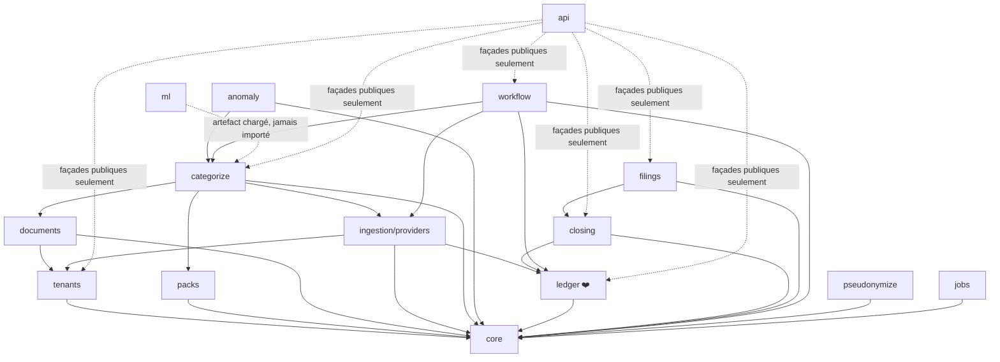

# 18 — Organisation du code

> Carte du code : où vit chaque module et quelles dépendances il a le droit
> d'avoir. L'état d'avancement n'est pas ici, il est dans le
> [doc 12](12-roadmap-todo.md). Dernière mise à jour : 2026-11-13.

Ce doc fait le lien entre l'arborescence réelle du repo (`backend/`,
`frontend/`) et le découpage en modules défini en [doc 03 §3](03-architecture.md#3--découpage-en-modules-monolithe-modulaire).
Chaque dossier de `backend/axelcompta/*/` a son propre `README.md` avec le
même triptyque : **rôle**, **statut démo (doc 17)** vs **statut V1 (doc 12)**,
**doc de référence**.

## Pourquoi l'arbre complet dès maintenant, alors que seule la démo est visée à court terme

Le module `ledger/` (par exemple) doit être écrit une fois, bien, avec les
bonnes frontières de dépendance — pas retravaillé quand on passera de la
démo à la V1. L'arbre ci-dessous est donc celui **du produit final** ; ce
qui change entre démo et V1, c'est le contenu de chaque dossier, jamais sa
position ni ses règles de dépendance.

## Vue d'ensemble

```text
AxeLCompta/
├── backend/axelcompta/
│   ├── core/          # Money, ids, erreurs, identité légale, accès DB
│   ├── tenants/       # portefeuilles, dossiers, RLS ; matrice statut × régime, avenants de régime
│   ├── packs/         # pack VTC réduit (V1 : taxonomie complète)
│   ├── ingestion/
│   │   └── providers/ # DataProvider ; Digifactory réel, client Rollee (AXE-818), fixtures
│   ├── documents/     # justificatifs en base, par tenant et dossier (AXE-425) ; OCR en V1
│   ├── categorize/    # règles + ML (garde de sens, abstention) + propositions apprises ; prompt du LLM, objectifs, seuils
│   ├── anomaly/       # profils par dossier, détecteurs V1 (AXE-437) ; qualifications en base (AXE-814)
│   ├── ledger/        # moteur pur, Postgres, écritures validées immuables
│   ├── closing/       # clôture fiscale : TVA, IS, liasse 2033 ; immobilisations, LOA, bilan d'ouverture depuis un FEC
│   ├── filings/       # CERFA 2065, 2031 et 2033 officiels, FEC légal, PDF (V1 : EDI/INPI)
│   ├── workflow/      # décisions humaines, signatures démo, journal d'audit, notifications internes
│   ├── api/           # api.app (+ /sante, /metrics) ; routes dans api/routes.py, jetons dans api/auth.py
│   ├── pseudonymize/  # seule porte vers un LLM : prompt pseudonymisé, fournisseur Anthropic (API Batch, AXE-887)
│   ├── jobs/          # file de jobs Postgres (ADR-002), exécutée par worker.py depuis le 2026-11-09
│   └── ml/            # V1 ; le modèle (v2) s'entraîne dans _AUDIT_DONNEES/entrainer_modele.py
├── frontend/          # Next.js : écrans gestionnaire (web) et chauffeur (mobile), auth Supabase
└── _AUDIT_DONNEES/    # audit du dataset historique, source pour packs/ et categorize/
```

## Graphe de dépendances (règle vérifiée par import-linter en CI, doc 03 §3)



**Ce que ce graphe interdit, explicitement (doc 03 §3) :**
- `ledger` → `categorize`, `ml`, ou `api` : jamais, dans aucun sens.
- `categorize` → `ledger` directement : passe obligatoirement par `workflow`.
- Tout import direct de `ml` au runtime : les modèles sont des artefacts chargés.

## Ce qui se passe en pratique pour la démo (doc 17)

La coupe verticale de la démo (« faire tourner tout le pipeline bout-en-bout
dès les premiers jours », doc 17 §2) traverse tous les modules « actif » ou
« réduit » du tableau ci-dessus. **Semaine 0 (faite) saute `categorize`** —
il n'entre en jeu qu'en semaine 2, une fois les vrais templates de
ventilation TVA nécessaires :

```
Chemin settlement (Rollee) :
  ingestion/providers → ingestion/reconciliation → ingestion/ecritures_settlement → ledger → closing → filings
   (fixtures golden      (reconcilier() : montant       (ventilation TVA          (512/706+   (compte de   (liasse
    test doc 17 §7)        ±1cts, fenêtre date,           réelle, doc 13 §5.3,      TVA)        résultat +   simplifiée,
                           libellé, doc 13 §4.2)          Uber/Bolt)                            bilan)       reportlab)

Chemin « reste des transactions » (carburant, péage...) — categorize inséré
au lieu d'ecritures_settlement, pas de ventilation TVA :
  ingestion/providers → categorize (règles + ML) → workflow/auto_accept → ledger → closing → filings
```

`tenants`, `packs`, `core` et `api` restent transverses. Les deux chemins
convergent dans le même `ledger` (Postgres). Les jeux de test sont
amorcés par `demo_seed`.

`backend/axelcompta/demo.py` est la composition root qui câble tout ça —
absent du découpage doc 03 §3 exprès : c'est un point d'entrée (comme `api/`),
pas un module d'architecture, donc pas soumis aux mêmes contraintes de
dépendance. Même statut pour les autres points d'entrée à la racine du
paquet : `api/routes.py` (l'API), `synchro_digifactory.py`, `notifier.py`,
`taches.py` (les tâches planifiées, lancées par
`scripts/taches_planifiees.sh` depuis un cron), `exercices.py` (le
passage d'un dossier à l'exercice suivant) et `affectations.py`
(l'affectation du résultat décidée par le chauffeur), et depuis le
2026-11-04 `agregats_portefeuille.py` (`--recalculer` remplit la table
`agregats_dossier` de la page Entreprises, `--verifier` la compare au
calcul complet). Depuis le 2026-11-09 : `worker.py` (le worker de la file
de jobs : import des dossiers, bouton « Synchroniser », rappels ; lancé
par `scripts/worker_planifie.sh`), `nouveaux_contacts.py` (les contacts
Digifactory sans dossier, proposés au gestionnaire, AXE-845) et
`rappels.py` (règles automatiques et envoi des rappels par e-mail et SMS,
AXE-808). Depuis le 2026-11-11 :

| Fichier | Rôle |
|---|---|
| `modeles_distants.py` | récupère le modèle de catégorisation dans le bucket S3 privé, empreinte vérifiée (AXE-847) |
| `registres_officiels.py` | relit l'INSEE et le RNE ; la comparaison est dans `tenants/registres.py` (AXE-849) |
| `tester_branchement.py` | bouton « Tester » d'une intégration (AXE-872) |
| `plateformes_rollee.py` | le chauffeur relie ses plateformes via Rollee Connect ; traitement des événements Rollee (AXE-819, AXE-820) |
| `webhooks_rollee.py` | secret et déclaration du webhook d'un branchement Rollee (AXE-820) |
| `revenus_rollee.py` | revenus Rollee → relevés → rapprochement → OD de ventilation, et leur contre-passation (AXE-821, AXE-889, AXE-911) |
| `rapprochement_rollee_service.py` | relie les users Rollee à leurs dossiers ; l'algorithme pur est dans `ingestion/rapprochement_rollee.py` (AXE-911) |
| `llm_synchro.py` | l'étage LLM dans les tâches planifiées : relever, soumettre, alerter ; budget dans `workflow/budget_llm.py` (AXE-887) |
| `prevenir_admins.py` | mail aux admins d'un cabinet par son SMTP par défaut (AXE-911) |

`api/app.py` est le point d'entrée HTTP depuis le 2026-10-25
(`uvicorn axelcompta.api.app:app`). Il sert l'app construite par
`api/routes.py`. Depuis le 2026-11-13 (AXE-840), les anciens fichiers
`demo_*` du chemin de production ont un nom de produit : `api/routes.py`,
`api/auth.py`, `comptes.py`, `comptes_memoire.py`,
`ingestion/digifactory_contacts.py`, `documents/justificatifs.py`,
`workflow/jalons.py`. `api/routes.py` reste hors du contrat
import-linter qui interdit à `api/` d'importer les modèles des modules
(`pyproject.toml`) : l'arête `api.app -> api.routes` est ignorée, à
retirer quand chaque route passera par la façade de son module
(AXE-428). `ingestion/digifactory_contacts.py` porte le mapping contact
Digifactory → dossier, appelé par
`scripts/ajouter_chauffeurs_digifactory.py`. Les scripts de jeux de
test gardent leur nom : `demo_seed.py`, `demo_chauffeurs_type.py`,
`demo_identites.py`, `demo_dossier_reel.py`, `demo_multi_dossiers.py`,
`ingestion/providers/chauffeurs_demo.py`.

## État

L'état du projet (fait, en cours, à faire) est tenu à un seul endroit : le
[doc 12](12-roadmap-todo.md). Ce doc-ci ne décrit que la carte du code.
L'ancienne section « Statut d'implémentation actuel », un journal daté du
02/09 au 25/09, est archivée telle quelle dans
[archive/18-statut-implementation-2026-09.md](archive/18-statut-implementation-2026-09.md).
